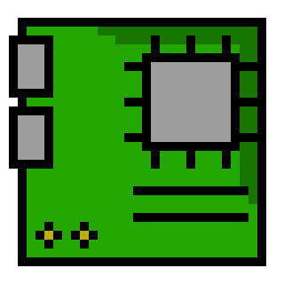

# Unified Systems Initiative

**Independent Software Development**

Building Systems, Defining Futures.

---

## Welcome

The Unified Systems Initiative (USI) is an independent software development initiative focused on operating systems, computing technologies and software experimentation.

USI provides an environment for exploring ideas, developing independent projects and experimenting with computing systems.

## Projects

### UDOS
**Unified Disk Operating System**

An independent operating system project exploring a unique DOS-inspired architecture and computing environment.

[View Repository](https://github.com/Unified-Systems-Initiative/UDOS)

## Development Areas

- Operating Systems
- System Software
- Computing Technologies
- Software Experimentation

## Official Website

[unified-systems-initiative.github.io/Website](https://unified-systems-initiative.github.io/Website/)

## Organization

GitHub: [Unified-Systems-Initiative](https://github.com/Unified-Systems-Initiative)

---

*Independent development. Original ideas. Systems built with purpose.*

Copyright © 2026 Unified Systems Initiative.
